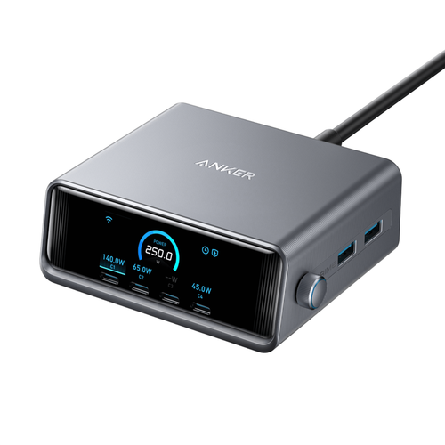

# Anker Prime for Homey Pro

[Русская версия](README.ru.md) · **[Installation for beginners](docs/INSTALL.en.md)** · [Установка с нуля](docs/INSTALL.ru.md) · [Releases](https://github.com/edsallo/homey-anker-prime/releases)

An unofficial Homey app for the **Anker Prime 250W, 6-port desktop charger (A2345)**. See what each USB port is doing, control charging, and configure the charger from Homey.



**Current app version: 0.1.8 — experimental community release.** This is a GitHub release, not a Homey App Store listing. Anker cloud access and an internet connection are required. There is no offline LAN control in this version.

## Compatibility

| Item | Support |
|---|---|
| Charger | Anker Prime **A2345** only |
| Homey | Homey Pro, firmware **13.5.0 or newer** |
| Hardware tested | Homey Pro (2023), Homey 13.5.0; A2345 firmware 2.1.1.6 |
| Other Homey Pro hardware | Not independently tested |
| Homey Cloud / Bridge alone | Not supported |
| Account | Charger already added to the Anker iPhone/Android app; Anker email/password login |
| Regions | Europe and Global endpoints; Europe tested on hardware |
| Languages | English and Russian |

## A compact device card

The main charger device has native Homey controls for **charging mode** and **selected port**. Choose C1, C2, C3, C4, A1 or A2; the readings tab shows:

- Total USB output power.
- Current charging mode.
- Selected port, including its optional friendly name.
- That port's power (W), voltage (V), and current (A), as separate numeric readings.

Selecting a port only changes the display. It does not change power delivery. The selected port is shared by everyone viewing this Homey device.

All 18 underlying port measurements continue to update separately, even though they are hidden from the main card. Their numeric values remain available for Insights and Flow. The three selected-port display readings have Insights and Flow tags disabled, so switching ports cannot mix their histories.

**USB output is not AC wall consumption.** The app does not report charger conversion losses, mains energy use, or accumulated USB energy.

## Optional devices for individual ports

After pairing the main charger, add **Anker → USB ports (optional)**. Choose only the ports you want:

| Device | Controls and readings |
|---|---|
| C1, C2, C3, C4 | On/off, power, voltage, current |
| A1 + A2 | One shared on/off control, combined power, individual A1/A2 power, voltage and current |

A1 and A2 have separate measurements but share one physical power-control group. Keep the main charger paired if you use these optional devices. Friendly names such as “Laptop” or “Desk phone” make individual tiles easier to recognize.

## Advanced settings of the main device

Open the charger card, then its gear/settings menu and **Advanced settings**. Menu wording can vary by Homey mobile-app version.

| Section | Available settings |
|---|---|
| Port names | Local Homey labels for C1–C4, A1 and A2 |
| Display | Brightness 20–100%, in steps of 5%; screensaver; display timeout |
| Display timeout | Never, 30 seconds, 1 minute, 5 minutes, 30 minutes |
| Controls | Forward/reverse encoder direction; priority for up to two USB-C ports |
| Clock and schedule | 12/24-hour format; clock-display start/end time; each weekday; Anker holiday mode |

The nine stock screensavers are **Celestial, Robotic, Lunar, Galactic, Meteorite, Floral Waltz, Impressionist Bloom, Sweet Treats, and Rhythmic Hue**. Their current download URLs and checksums are obtained from Anker when applying a theme. “Other / from Anker” preserves a theme outside this catalogue; it does not upload an image.

Settings synchronize from the charger, including changes made in the Anker app or by a Flow. Times use the charger's local clock. Saving settings sends the relevant commands and waits for device confirmation. A failed save may follow a partially applied multi-setting change: review the current settings before retrying.

Charging mode and port selection stay in the main card; they are not duplicated in Advanced settings.

## Dashboard widget (optional)

Add **Anker Prime** from Anker's widgets to a Homey dashboard/home screen. This is separate from the device card.

The widget provides all six ports at a glance, total power, W/V/A readings, five power switches, port names, a short graph for the current viewing session, timer shortcuts, a custom off timer, and weekly port on/off schedules. The display/mode page provides convenient controls for mode, brightness, timeout, clock format, encoder direction and USB-C priority.

An off timer supports 5-minute steps up to 1,435 minutes; 0 cancels it. Start and end schedule events are saved independently. A1/A2 timers and schedules apply to both ports. The short widget graph is not permanent storage; use Insights for retained numerical history. Widget layout was browser-tested; complete iPhone widget verification is still pending.

## Flow and Advanced Flow

The main device exposes **13 app-specific cards**:

| Category | Cards |
|---|---|
| When (3) | Port power changed (port and on/off tokens); charging mode changed; connection state changed |
| And (1) | Selected port power is / is not enabled |
| Then (9) | Set port power; off timer; charging mode; display brightness; display timeout; clock format; encoder direction; USB-C priority; port schedule event |

“Selected port” in the condition means the port chosen in that Flow card, not the card's display selector. Flow actions offer C1–C4 and the shared A group. Charging modes: AI Power, connection priority, dual laptop and low power. Port schedule days include every day, weekdays, weekends or an individual day; use the widget for arbitrary combinations.

Optional port devices also use Homey's standard on/off and measurement capabilities. Hidden per-port numeric tags can be used in logic and numerical comparisons. Display-selector measurements deliberately have no tags.

Examples: dim the charger display at night; turn off a particular port on a schedule; notify when cloud connectivity changes. There is no dedicated “charging finished” detector or “power stays below X for Y minutes” card; those require your own Flow logic and timing.

## Installation

**Never installed a development app before? Start with the [English step-by-step guide](docs/INSTALL.en.md) or [Russian guide](docs/INSTALL.ru.md).** No programming knowledge, Git installation, Docker or always-on computer is needed. You do need a computer for initial installation and updates.

For experienced users, in the extracted project directory:

```sh
npm ci
npm run homey -- login
npm run homey -- select
npm run install:homey
```

The installer builds using a pinned official Homey CLI and uploads the app using the CLI's authenticated Homey connection. It uses a buffered upload to avoid the `Missing File` stream-upload failure encountered during development. Existing pairing data is preserved. After installation, close the terminal; the app runs on Homey.

Homey credentials are used by the installer. **Anker credentials are entered later in Homey's pairing screen**, not in the terminal or source code.

## Validation and limitations

Hardware-verified: Anker login/discovery, six-port telemetry, reconnection after app restart, port-display selection, optional-port discovery, and advanced-setting changes for brightness, stock screensaver, display timeout, encoder direction, clock format, clock schedule and holiday mode. Test settings were restored afterwards. Brightness was also verified through Flow.

Implemented but not fully hardware-verified: switching power on occupied ports, charging-mode changes, USB-C priority and port power schedules/timers. Ten automated tests cover authentication, packet validation, malformed frames, command inputs, confirmation waiting and command sequencing. Homey `publish` validation passed; this is not App Store certification.

Not implemented: custom profile creation/selection from Homey, per-profile charging-protocol tuning, custom screensaver uploads, firmware updates, cloud port-label synchronization, offline LAN control, accumulated USB-energy estimation. If a custom Anker charging profile is active, its status is shown; select it in the Anker app. No charging protection or firmware settings are bypassed.

Anker's API is unofficial and can change. Readings become unavailable when stale or disconnected. Commands are not treated as successful simply because they were sent: a matching charger status must confirm them.

## Privacy and credentials

Each user supplies their own Anker account during pairing. Email, password and session data are stored in the app's private `/userdata` directory on Homey (file mode 0600), not in device settings, widget responses or the repository. The password is retained to renew expired sessions; the file is **not additionally encrypted by this app**. Account data is removed when the last paired device using it is deleted. Use the main device's repair/reconnect function after changing your Anker password.

Login and catalogue requests use Anker HTTPS endpoints. Telemetry and commands use certificate-verified MQTT over TLS. Stock theme selection instructs the charger to retrieve Anker's theme asset. There is no project-operated backend or analytics service. The computer's Homey CLI stores its own Homey authorization separately.

## Development and support

```sh
npm ci
npm test
npm run validate
npm run build:check
```

`build:check` builds an install archive under `dist/` without contacting or installing on Homey. Runtime dependencies are separate from development tools; Node.js 24 or newer on the installation computer is required. The installation helper is a repository utility using pinned CLI internals, not an official Athom installer.

For bugs, [open an issue](https://github.com/edsallo/homey-anker-prime/issues) with app/Homey/charger versions, expected behavior and reproduction steps. Remove account details, serial numbers, passwords, tokens and certificates from attachments. English and Russian reports are welcome. Tested installation platform: macOS; Windows instructions use portable Node/npm commands but have not yet been tested on a physical Windows machine.

MIT for application code; see [LICENSE](LICENSE) and [THIRD_PARTY.md](THIRD_PARTY.md). Protocol research credits: [thomluther/anker-solix-api](https://github.com/thomluther/anker-solix-api). Anker branding/product photos remain their owners' property. This project is not affiliated with or endorsed by Anker or Athom.
